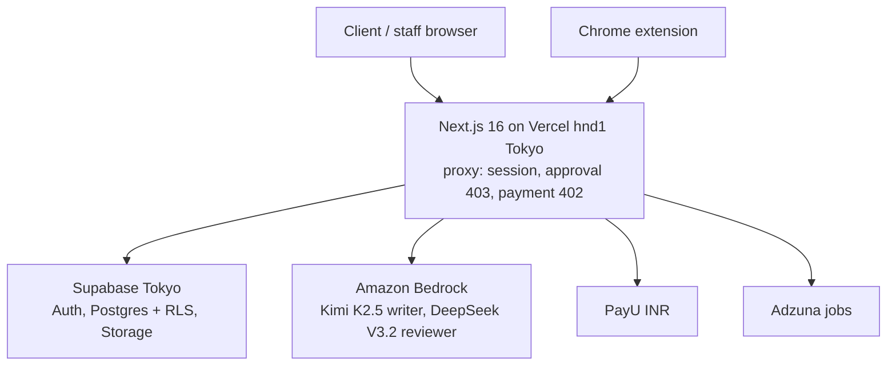

# Nextzen Orbit: app overview

Last reviewed from code: 2026-10-26 (beta merged; see [CHANGELOG.md](CHANGELOG.md)).

## Purpose

Nextzen Orbit is a done-for-you job search service. Clients apply and are reviewed. After paying for a plan, a team of recruiters applies to jobs for them each month with tailored resumes and cover letters. Clients also get self-serve AI tools to build resumes, check them against job descriptions, write cover letters, learn about careers and track applications. A Chrome extension helps fill application forms; the user always submits.

## What the product does

**For clients:**

- Sign in with Google (or email/password for SSO accounts), then apply with a profile and resume.
- After approval, pay for a plan: Silver, Gold or Elite.
- Build, upload, AI-improve, tailor and export resumes, using six templates (Harvard, Jake's, Deedy, Awesome CV, FAANGPath, AltaCV) plus three contract (C2C) templates, at an exact page count.
- Analyze a resume against a job description; generate cover letters.
- Track applications on a Kanban board or table.
- Search jobs (Adzuna, many countries) and save searches.
- Use career pages: roadmaps, interview questions, videos, AI notes, projects.
- See what the team did for them (progress feed) and message the team.
- Optimize their LinkedIn profile, compare job offers (CTC → in-hand), and practise AI mock interviews.
- Use the assisted autofill extension.

**For staff:**

- Review signup applications (supervisors).
- Allocate clients to admin teams, with monthly application targets per plan.
- Search jobs for a client, queue them, claim them, apply, and mark them applied (with credit).
- Generate tailored resumes and cover letters per client, or in the standalone workspace.
- Reply to client messages.
- See analytics, manage the team, SSO users and notifications. Supervisors approve extra daily AI allowance.

## Primary journeys

1. **Client onboarding:** Google sign-in → onboarding form + resume → pending → approved → pay → dashboard.
2. **Done-for-you loop:** supervisor allocates → admin searches → queues → tailors documents → applies → marks applied → target progress.
3. **Self-serve resume:** upload → AI parse → edit → improve or optimize against a JD (quality-checked) → export PDF/DOCX/LaTeX.

## Architecture at a glance

## Main UI areas

| Area | Paths |
| --- | --- |
| Marketing | `/`, `/compliance`, `/privacy`, `/refund`, `/terms` |
| Auth and onboarding | `/login`, `/register`, `/verify`, `/onboarding`, `/onboarding/terms` |
| Client app | `/dashboard`, `/profile`, `/resumes`, `/resumes/[id]`, `/analyzer`, `/cover-letter`, `/applications`, `/job-search`, `/career`, `/career/[slug]`, `/messages`, `/linkedin`, `/offers`, `/interviews/mock`, `/subscription`, `/settings` |
| Staff | `/admin/login`, `/admin`, `/admin/users`, `/admin/apply-queue`, `/admin/job-search`, `/admin/create-resume`, `/admin/create-cover-letter`, `/admin/signup-applications`, `/admin/team`, `/admin/analytics`, `/admin/messages`, `/admin/ai-limits`, `/admin/sso-users`, `/admin/settings` |

## Data at a glance

Accounts (`users`, `profiles`, `signup_applications`, `subscriptions`, `payment_orders`), documents (`resumes`, `resume_versions`, `admin_resumes`, `admin_cover_letters`, `admin_documents`, `document_jobs`), jobs (`jobs`, `job_queue`, `saved_job_searches`, `client_admin_assignments`, `applications`), client features (`client_messages`, `mock_interviews`), AI limits (`ai_usage_events`, `ai_quota_requests`), and the career workspace. Full detail: [DATABASE_SCHEMA.md](DATABASE_SCHEMA.md).

## Status and known gaps

- USD checkout is a placeholder. Client cover letters aren't saved.
- The site/app/admin domain split is built but off in production until it's configured ([domain-separation.md](domain-separation.md)).

## Where to read next

[APP_DOCUMENTATION.md](APP_DOCUMENTATION.md) for every flow and file, [ARCHITECTURE.md](ARCHITECTURE.md) for design, and [`../README.md`](../README.md) for the full map.
